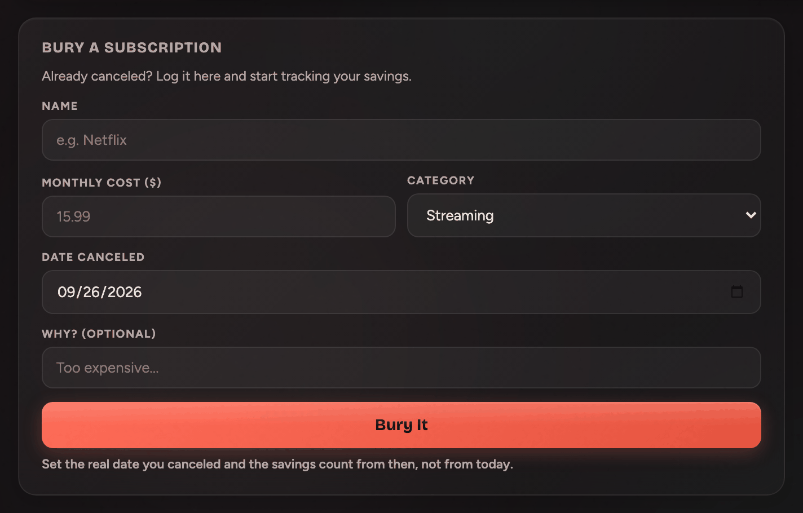
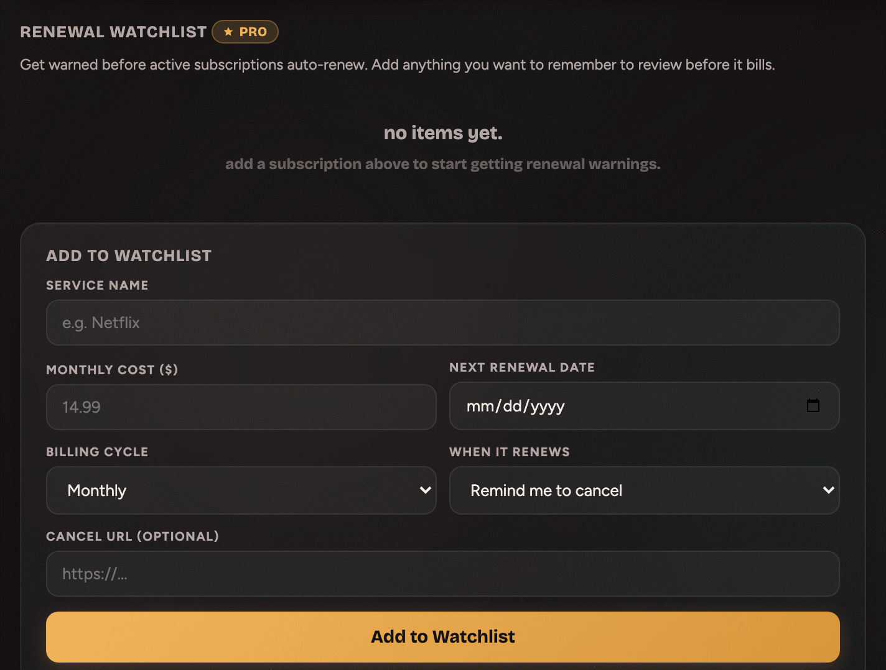

# Subscription Graveyard 🪦

**A savings tracker for the subscriptions you finally canceled.** Every one gets a tombstone that counts what it's saved you, every day it stays dead. A Crypt Keeper runs the place and has opinions about your spending.

**[Start with a free plan at subscriptiongraveyard.app](https://subscriptiongraveyard.app)**. No setup, no card. Or run your own copy with the code in this repo.


---

## What it does

| Tab | What you get |
|---|---|
| **Graveyard** | One tombstone for each subscription you canceled, with what it has saved you so far. Stones age from Fresh to Resting, Weathered and Legendary the longer they stay buried. |
| **Last Rites** | A waiting room for the ones you keep meaning to cancel. When you finally do, move it to the graveyard and it starts earning. |
| **Stats** | Your monthly savings, the total saved since each burial, where the money was going, and your rank from Ghost up to Grim Reaper. |
| **Bury** | The form. Set the real date you canceled and the savings count from then, not from today. |
| **Renewal Alerts** | Pro. An email before an active subscription bills again, with a cancel link or a short script for asking for a better deal. On your own copy this needs a Pro hub (see Settings). |

It never connects to your bank or cancels anything for you. You type in what you canceled. It also works on your phone and has a full how-to guide built in.

<p>


</p>

---

## Two ways to use it

### 1. Use the hosted version (easiest)

Go to **[subscriptiongraveyard.app](https://subscriptiongraveyard.app)** and sign up. The free plan holds 5 buried subscriptions and 5 in Last Rites, with every counter, rank and stat. Pro removes both limits and turns on renewal alerts. Pro comes through the [Jen Built It App Hub](https://jenbuiltit.com/app-hub): $7 a month, $59 a year or $119 once, and one Pro covers all five apps in the hub. Paying for Pro is also how you support the project.

### 2. Run your own copy

**What a copy gives you:** your copy runs the free plan for everyone. That's 5 buried subscriptions and 5 in Last Rites per account, with every counter, rank and stat. You can raise or remove those caps (see Free plan limits below). Pro, with no caps and Renewal Alerts, isn't sold on a copy. The **Go Pro** button opens a short note that Pro is part of the hosted version at subscriptiongraveyard.app, with no price and no checkout. To offer Pro on your own copy you connect your own Pro hub in Settings.

Subscription Graveyard runs on Cloudflare Workers with a D1 database. You'll need [Node.js](https://nodejs.org) 22 or newer. Trying it on your own computer needs no Cloudflare account. Putting it online needs one, and a free account is enough.

**Try it on your computer:**

```bash
git clone https://github.com/jensoltys/subscriptiongraveyard.git
cd subscriptiongraveyard
npm install
cp .dev.vars.example .dev.vars
```

Open the new `.dev.vars` file and put a long random string after `JWT_SECRET=` (32 or more characters). `openssl rand -hex 32` prints a good one. Until that's set, sign up and log in answer "This server isn't set up yet".

```bash
npm run db:setup:local
npm run dev
```

Open `http://localhost:8787`. With `DEV_LOG_CODES=true` in `.dev.vars`, the 6-digit signup code and any password reset link print in your terminal, so you can test without setting up email. Running on a different port? Change `APP_URL` in `.dev.vars` to match, because the printed reset link uses it.

**To put it online:**

Create your database, then paste the `database_id` it prints into `wrangler.toml`:

```bash
npx wrangler d1 create subscription-graveyard
```

Set `APP_URL` and `FROM_EMAIL` in `wrangler.toml` to your live address and your sender, so the very first emails carry the right links. Then:

```bash
npm run db:setup:remote
npx wrangler secret put JWT_SECRET
npx wrangler secret put RESEND_API_KEY      # signup codes, password resets and renewal warnings
npm run deploy                              # runs the security scan, then deploys
```

Use `npm run deploy`, not `npx wrangler deploy`. Only the npm script runs the security scan first. Renewal warnings go out once a day at 14:00 UTC (the `crons` line in `wrangler.toml`), and only to accounts that have Pro.

### Settings

| Setting | Needed? | What it's for |
|---|---|---|
| `JWT_SECRET` | **Yes** | Signs logins. The app refuses to start a session without a 32+ character secret. |
| `APP_URL` | **Yes** | Your site's address. Links in emails point here, and so do the link-preview and canonical tags on every page. |
| `APP_NAME` | Optional | The app's name in alert and feedback webhook messages. Set in `wrangler.toml`. |
| `RESEND_API_KEY` + `FROM_EMAIL` | For a live site | Sends signup codes, password resets and renewal warnings through [Resend](https://resend.com). If `FROM_EMAIL` is blank, emails go out from Resend's test sender, `onboarding@resend.dev`, which only delivers to the email on your own Resend account. Set it to an address on a domain you've verified in Resend. |
| `ALERT_WEBHOOK_URL` + `ALERT_TOKEN` | Optional | Get a message when the server hits an error. |
| `SIGNUP_WEBHOOK_URL` + `SIGNUP_WEBHOOK_SECRET` | Optional | Get a message on each new signup. |
| `FEEDBACK_WEBHOOK_URL` | Optional | Where the in-app feedback button sends messages. Blank hides the Feedback button. |
| `PRO_LOOKUP_URL`, `PRO_REFRESH_URL`, `HUB_JWT_SECRET`, `HUB_LOOKUP_SECRET`, `RECAP_SERVICE_SECRET` | Optional | Connect a Pro hub like the one subscriptiongraveyard.app uses. Leave them blank and everyone is on the free plan. The three secrets need 32 or more characters each. A shorter one counts as not set, because a short secret would let anyone forge a login or Pro. |
| `UPGRADE_URL` | Optional, needs a hub | Where **Go Pro** sends people once your hub is connected (`HUB_JWT_SECRET` set). Must start with `https://` or `http://`. Blank hides Go Pro. |
| `PRO_PRICE_TEXT` | Optional, needs a hub | The price line in the Pro popup, like `$5 a month`. Blank shows no price. |

**Renewal Alerts are Pro-only and need a Pro hub.** On a copy without one they stay locked for everyone, and the daily job sends no renewal emails. Raising the free plan limits doesn't change that.

**Free plan limits** are `FREE_BURIALS` and `FREE_LAST_RITES` near the top of `src/worker.js`. Both start at 5. Change them however you like on your own copy, then deploy again. A very large number works as no cap. They cover burials and Last Rites only. When someone hits a cap on a copy with no Pro hub, they see the same note as Go Pro: Pro is part of the hosted version.

### Before you run it publicly

Replace these before you go public:

- [ ] `YOUR COMPANY NAME`, `YOUR BUSINESS ADDRESS` and the contact emails in `public/legal/`, the page footers and `EMAIL_SENDER_LINE` in `src/worker.js` (it goes at the bottom of every email).
- [ ] `YOUR STATE` and `YOUR COUNTY` in `public/legal/terms.html` (governing law and courts).
- [ ] The source code link in the footers and in `public/legal/terms.html`, if you run a changed version (the AGPL asks you to offer your own code).
- [ ] The lines in `public/legal/` that depend on your setup: Cloudflare Web Analytics and affiliate links in `privacy.html` and `do-not-sell.html`, and the line marked `EDIT THIS LINE` in `accessibility.html`.
- [ ] The Pro lines marked `EDIT OR DELETE THIS if your copy has no Pro hub` in `public/legal/terms.html` (sections 1 and 4) and `public/legal/privacy.html` (the Pro status, App Hub and recap items, and section 13). They describe buying Pro through a hub with Stripe. Rewrite them for how your copy sells Pro, or delete them if it doesn't.
- [ ] `YOUR-DOMAIN` in `public/robots.txt` (uncomment the Sitemap line once you have one).
- [ ] `public/.well-known/security.txt`: the `security@example.com` contact, the `example.com` address and the `Expires` date.
- [ ] `public/og.png`, the social share image. It shows subscriptiongraveyard.app in the corner. The tags that point to it use your `APP_URL`, so you only swap the picture.

Pro is part of the hosted version. On a copy with no Pro hub connected, the **Go Pro** button opens a short note that Pro lives on subscriptiongraveyard.app, and the Pro price and billing lines stay hidden, so nobody pays for something that won't work on your copy. Once you connect your own hub, **Go Pro** goes to your `UPGRADE_URL` and the popup shows your `PRO_PRICE_TEXT`. Leave `UPGRADE_URL` blank and Go Pro stays hidden. The app also shows a few tips that link to my other apps and posts. They're in the `GENERAL_NUDGES` list in `public/app.js`. No affiliate links ship in this repo.

### Keep your copy as safe as subscriptiongraveyard.app

Your copy is built from the same source as subscriptiongraveyard.app, with the hosted site's own hookups turned into optional settings. So it gets the same protections: hashed passwords, a lockout after 5 wrong passwords, limits on signup-code guesses (8 a minute, 5 misses burn a code, 20 misses a day), every other session signed out when a password changes, reset links that die once one is used, and checks that block requests from other websites. Logging out clears the session on that device, and changing the password signs out every device. A few of those depend on your setup:

- [ ] **Use a long random `JWT_SECRET`.** The app won't log anyone in without one of 32+ characters. `openssl rand -hex 32` makes a good one. The same goes for the Pro hub secrets if you connect a hub.
- [ ] **Set up email before going live** (`RESEND_API_KEY` and `FROM_EMAIL`). Never set `DEV_LOG_CODES` on a live site.
- [ ] **Keep secrets out of git.** Store them with `npx wrangler secret put`, never in `wrangler.toml`. `.dev.vars` is already ignored.
- [ ] **Stay updated.** Security fixes made on subscriptiongraveyard.app get copied here. Click **Watch** at the top of this page to hear about them, then pull and redeploy.

Found a security problem? See [SECURITY.md](SECURITY.md).

---

## Tests

```bash
npm test                # unit tests, including parallel-request rate limit checks
npm run test:security   # scans for common security mistakes
```

## Made by

**Jen Soltys**. I build small apps that fix everyday annoyances at **[Jen Built It](https://jenbuiltit.com)** and write about building with AI at **[jen8n.com](https://jen8n.com)**.

If Subscription Graveyard helps you, the best support is a **[Pro plan](https://jenbuiltit.com/app-hub/upgrade?from=graveyard)** or a ⭐ on this repo.

## Contributing

Bug reports and ideas are welcome in [Issues](../../issues). I'm not taking pull requests right now, which keeps the commercial license option possible. You're free to fork it and make it yours under the license below. See [CONTRIBUTING.md](CONTRIBUTING.md) and the [code of conduct](CODE_OF_CONDUCT.md).

**Getting help:** self-hosted copies are community-supported. You run your copy, so you handle its setup, updates, backups and security. [SUPPORT.md](SUPPORT.md) says where to ask.

## License

[AGPL-3.0](LICENSE). You can use, change and share Subscription Graveyard. If you run a changed version as a website for other people, you have to share your changed code under the same license.

### Commercial license

Want to build Subscription Graveyard into a product without sharing your code, or run a changed version for customers without publishing your changes? You can buy a commercial license that replaces the AGPL terms for your business. Email **hello@jenbuiltit.com** with what you're building.

Subscription Graveyard isn't affiliated with or endorsed by any of the services named in it or in these screenshots. Netflix, Disney+, Hulu, Adobe Creative Cloud, Peloton, HelloFresh, Audible, Xbox Game Pass and every other product name here are trademarks of their respective owners.

## Trademarks

The license covers the code, not the name. "Subscription Graveyard", its logo and its look aren't licensed for your own product. If you run a changed copy for other people, give it your own name and branding. Saying it's "powered by Subscription Graveyard" is fine. Don't present your copy as the original or as run or endorsed by Jen Built It.
